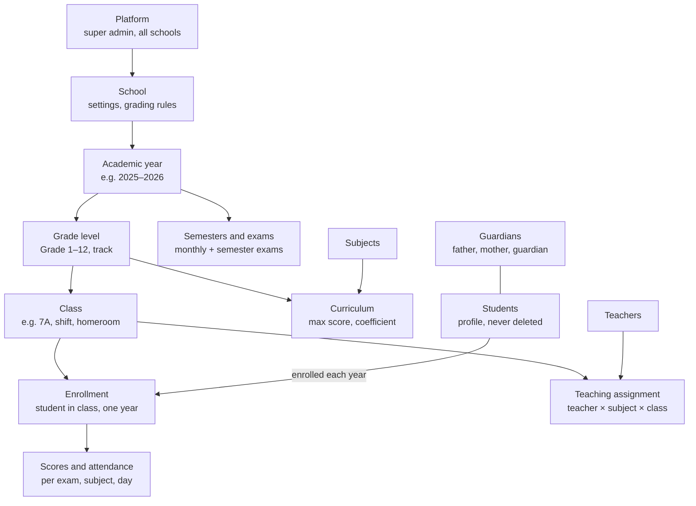
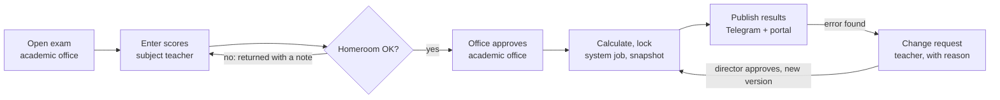
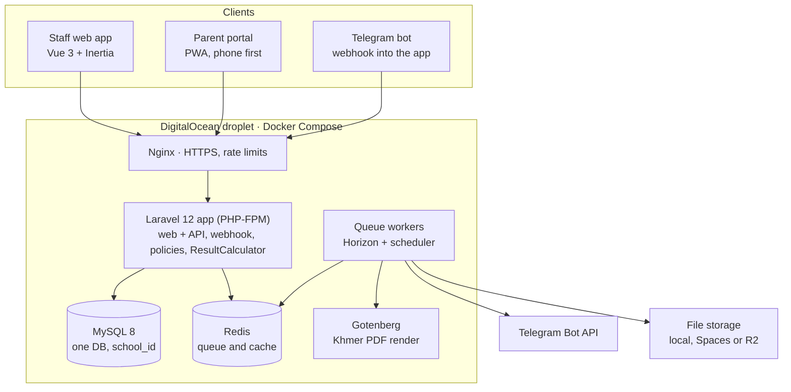

# Cambodia School Management System — Architecture Plan

Oct 21, 2026 · HIN CHEU

## Summary and corrections

Build one multi-school (multi-tenant) app where every record belongs to a school, and every class, score and rank belongs to an academic year. Your core idea is right; the corrections below prevent a painful rewrite once the second school year starts.

| Your idea                             | Correction                                                                                                       | Why it matters                                                         |
|---------------------------------------|------------------------------------------------------------------------------------------------------------------|------------------------------------------------------------------------|
| Student belongs to a class            | Student belongs to a school; a yearly **enrollment** links student → class                                       | Students change class every year; transcripts need every past year     |
| Teacher belongs to a class            | **Teaching assignment** = teacher × subject × class × year, plus one **homeroom teacher** (គ្រូបន្ទុកថ្នាក់) per class | One teacher teaches many classes; one class has many teachers          |
| Exam has many subjects                | **Exam** (monthly / semester) → **curriculum** row per grade with max score and coefficient → **scores**         | Max score and weight differ by grade and by Science / Social track     |
| Store the ranking                     | Compute rank in a job; save a **result snapshot** only when the exam is locked                                   | Ranks never go stale, and printed report cards never change silently   |
| Parent info inside the student record | Separate **guardians** table, many-to-many with students                                                         | Siblings share parents; a child can have father, mother and a guardian |
| Teacher enters score, done            | Enter → homeroom review → academic office approval → lock → publish                                              | Stops edits after report cards are printed; every change is logged     |
| One login table per role              | One **users** table + a role per school; profiles in teachers, guardians, students                               | One person can be a teacher at one school and a parent at another      |

Also missing from the idea: academic years and semesters, attendance (with and without permission), conduct, promotion or repeat decisions, transfers, Khmer report-card PDFs, an audit log, and Telegram notifications to parents.

## Cambodia-specific requirements

Make every rule below a per-school setting, not code: public, private and Khmer-English schools all differ. These come from general MoEYS practice, so confirm exact formulas and bands with a real school before launch.

**Education levels (MoEYS 6 + 3 + 3)**

| Stage                      | Grades         | Notes                                                                              |
|----------------------------|----------------|------------------------------------------------------------------------------------|
| Preschool (មត្តេយ្យ)         | Nursery, K1–K3 | Optional; mostly observation, not scores                                           |
| Primary (បឋមសិក្សា)          | 1–6            | Subjects often scored out of 10                                                    |
| Lower secondary (អនុវិទ្យាល័យ) | 7–9            | Ends with the Grade 9 national exam                                                |
| Upper secondary (វិទ្យាល័យ)   | 10–12          | Grades 11–12 split into Science and Social Science tracks; ends with BacII (បាក់ឌុប) |

**Exam calendar**

- Monthly exams (ប្រឡងប្រចាំខែ) in most months
- Two semester exams (ប្រឡងឆមាសទី១ / ទី២)
- Semester result combines the monthly average with the semester exam; annual result (លទ្ធផលប្រចាំឆ្នាំ) combines both semesters and decides promotion
- Academic year start and end dates are a setting — MoEYS has moved them in recent years

**Scores, averages, mentions**

- Each subject has its own maximum score per grade; many schools divide the total by a fixed divisor (មេចែក) per grade to get the average (មធ្យមភាគ)
- Mentions (និទ្ទេស) with configurable bands: ល្អប្រសើរ, ល្អណាស់, ល្អ, ល្អបង្គួរ, មធ្យម, ខ្សោយ
- National exam results stored as letters A–F (A–E pass, F fail)

**Ranking (ចំណាត់ថ្នាក់)**

- Rank inside the class by average; equal averages share a rank and the next rank is skipped (1, 2, 2, 4)
- Optional rank across the whole grade (7A + 7B + 7C) and top-student lists (សិស្សពូកែ)

**Attendance and shifts**

- Absent with permission (មានច្បាប់), absent without permission (ឥតច្បាប់), late
- Morning and afternoon shifts (វេនព្រឹក / វេនរសៀល) in the same building

**People and data**

- Names in Khmer script and Latin; gender; date and place of birth using village / commune / district / province
- Every statistics report shows **total and female** counts (សរុប / ស្រី) — MoEYS style
- ID Poor card (ប័ណ្ណក្រីក្រ) level for scholarships and fee waivers
- Phone numbers +855; Telegram is the main parent channel, SMS as backup
- Khmer and English UI; optional Khmer numerals (០១២៣) on printed documents

**Private schools**

- Tuition in USD and KHR; payment via KHQR (Bakong) or ABA PayWay
- Parallel programs: Khmer program + English program (part-time), each with its own classes and grades

## Users, roles and permissions

Nine roles cover a Cambodian school; a role is always granted **per school**, so one login can hold different roles in different schools.

| Role                                   | Scope                    | Main actions                                                                                |
|----------------------------------------|--------------------------|---------------------------------------------------------------------------------------------|
| Platform super admin                   | All schools              | Create schools, subscription plans, global subject and grading templates, support access    |
| Director (នាយក)                        | One school               | All settings, approve and publish results, sign report cards                                |
| Deputy / academic office (ការិយាល័យសិក្សា) | One school               | Academic years, classes, curriculum, exams, approve scores, timetable                       |
| Registrar / admin staff                | One school               | Admit students, guardians, enrollments, transfers, certificates                             |
| Accountant                             | One school               | Fees, invoices, payments, receipts                                                          |
| Homeroom teacher (គ្រូបន្ទុកថ្នាក់)          | Own class                | Daily attendance, conduct, review all subject scores, report-card comments, contact parents |
| Subject teacher                        | Assigned class + subject | Enter scores for own subjects, lesson attendance, homework                                  |
| Parent / guardian                      | Own children             | View scores, rank, attendance, fees, announcements; request leave; acknowledge report card  |
| Student                                | Self                     | View own results, timetable, homework                                                       |

Implementation: `spatie/laravel-permission` with **teams = school_id** for roles, plus Laravel Policies for row-level rules — e.g. a teacher may edit a score only if a teaching assignment links them to that class and subject, and the exam is still open.

## Domain model

Students, guardians, teachers and subjects live at school level and persist; classes, enrollments, exams and scores are recreated inside each academic year.



*Every score hangs on a yearly enrollment, not on the student.*

- **Year rollover wizard**: copy grade levels, curriculum and classes into the new year, then promote students using each one's promotion decision.
- A class called "7A" exists every year, but it is a **new row** each year with its own homeroom teacher and students.
- Optional **campus / branch** level between school and year for private chains with several sites.
- Never hard-delete a student: use a status (active, transferred, dropped out, graduated) so history and statistics stay correct.

## Database schema

About 35 tables; every school-owned table carries `school_id` (indexed) and every yearly table carries `academic_year_id`. Use `classrooms` instead of `classes` because `class` is reserved in PHP.

**Tenancy and accounts**

| Table         | Key columns                                                                                                                                                                                     | Notes                                                             |
|---------------|-------------------------------------------------------------------------------------------------------------------------------------------------------------------------------------------------|-------------------------------------------------------------------|
| `schools`     | code, name_km, name_en, type (public / private / international), stage (primary / secondary / K-12), province, district, commune, moeys_code, logo, brand_color, report_header, settings (json) | Settings json holds grading formulas, locale, Khmer numerals flag |
| `users`       | name, email (nullable), phone, password, telegram_chat_id, locale, 2fa                                                                                                                          | Parents often log in by phone, not email                          |
| `school_user` | school_id, user_id, role, status                                                                                                                                                                | Membership; roles via spatie teams                                |

**Academic structure**

| Table                 | Key columns                                                                                          | Notes                                                 |
|-----------------------|------------------------------------------------------------------------------------------------------|-------------------------------------------------------|
| `academic_years`      | name (2025–2026), start_date, end_date, is_current, status                                           | Only one current per school                           |
| `terms`               | academic_year_id, name (Semester 1 / 2), start, end, sort                                            |                                                       |
| `grade_levels`        | number (0–12), name_km, stage                                                                        | 0 = kindergarten                                      |
| `tracks`              | name (Science / Social Science)                                                                      | Optional; mainly Grades 11–12                         |
| `subjects`            | code, name_km, name_en, category                                                                     | Master list per school, seeded from MoEYS template    |
| `curriculum_subjects` | academic_year_id, grade_level_id, track_id, subject_id, max_score, coefficient, pass_score, sort     | Changing max score next year never breaks old results |
| `grade_divisors`      | academic_year_id, grade_level_id, track_id, divisor                                                  | The មេចែក used for averages                           |
| `classrooms`          | academic_year_id, grade_level_id, track_id, name (7A), shift, room_id, homeroom_teacher_id, capacity |                                                       |
| `rooms`               | name, building, capacity                                                                             |                                                       |

**People**

| Table              | Key columns                                                                                                                                                                                                               | Notes                                           |
|--------------------|---------------------------------------------------------------------------------------------------------------------------------------------------------------------------------------------------------------------------|-------------------------------------------------|
| `students`         | student_code, birth_cert_no, last_name_km, first_name_km, last_name_en, first_name_en, gender, dob, birth_village / commune / district / province, current address, photo, id_poor_level, disability, admitted_at, status | Status: active, transferred, dropped, graduated |
| `guardians`        | user_id (nullable), name_km, name_en, gender, occupation, phone, telegram, address                                                                                                                                        | One guardian, many children                     |
| `guardian_student` | guardian_id, student_id, relationship (father / mother / guardian), is_primary_contact, can_pickup                                                                                                                        |                                                 |
| `teachers`         | user_id, staff_code, names km / en, gender, dob, phone, qualification, employment_type (civil servant / contract / volunteer), hired_at, status                                                                           |                                                 |
| `enrollments`      | student_id, classroom_id, academic_year_id, roll_no, status, joined_at, left_at                                                                                                                                           | **Unique (student_id, academic_year_id)**       |

**Teaching and exams**

| Table                             | Key columns                                                                                                                     | Notes                                                |
|-----------------------------------|---------------------------------------------------------------------------------------------------------------------------------|------------------------------------------------------|
| `teaching_assignments`            | academic_year_id, classroom_id, subject_id, teacher_id, hours_per_week                                                          | Drives who can enter which scores                    |
| `exams`                           | academic_year_id, term_id, type (monthly / semester / final / quiz), month, name, start_date, end_date, status, grade_level_ids | Status: draft → open → approved → locked → published |
| `exam_subject_status`             | exam_id, classroom_id, subject_id, status, submitted_by, approved_by                                                            | Tracks progress per subject per class                |
| `scores`                          | exam_id, enrollment_id, subject_id, score decimal(5,2), mark (present / absent / exempt), entered_by, updated_by                | **Unique (exam_id, enrollment_id, subject_id)**      |
| `exam_results`                    | exam_id, enrollment_id, total, average, rank_class, rank_grade, mention, passed, absent_count, version, computed_at             | Snapshot written on lock                             |
| `term_results` / `annual_results` | enrollment_id, term_id, average, rank_class, mention, decision                                                                  | Same idea, one per semester and year                 |
| `grading_scales`                  | stage, bands json (min, max, mention_km, mention_en, letter)                                                                    | Per school, per stage                                |
| `score_change_requests`           | score_id, old_score, new_score, reason, requested_by, approved_by, status                                                       | Only way to change a locked score                    |

**Attendance, conduct, records**

| Table                            | Key columns                                                                                                                              | Notes                                    |
|----------------------------------|------------------------------------------------------------------------------------------------------------------------------------------|------------------------------------------|
| `attendances`                    | enrollment_id, date, session (morning / afternoon / period n), status (present / permission / no_permission / late), reason, recorded_by |                                          |
| `leave_requests`                 | student_id, guardian_id, from_date, to_date, reason, attachment, status                                                                  | Approved request auto-marks "permission" |
| `conduct_records`                | enrollment_id, term_id, grade, comment, incidents                                                                                        |                                          |
| `promotions`                     | enrollment_id, decision (promote / repeat / graduate), decided_by, note                                                                  | Feeds the year rollover                  |
| `transfers`                      | student_id, direction (in / out), other_school, date, certificate_no                                                                     |                                          |
| `attachments`                    | morphs (attachable), type (birth certificate, family book, photo), path                                                                  | Stores disk + relative path, never a URL |
| `announcements`, `notifications` | audience (school / grade / class / person), channel, sent_at                                                                             |                                          |
| `activity_log`                   | subject, causer, old / new values                                                                                                        | spatie/laravel-activitylog               |

## Exams, scores, ranking and mentions engine

Put all calculation in one service class (`ResultCalculator`) driven by the school's settings json, so a new school with different rules needs configuration, not code.

**1. Exam average** — three methods, chosen per stage:

```math
\text{Divisor:}\quad \bar{x} = \frac{\sum_{s} score_s}{divisor_{grade}}
```

```math
\text{Weighted:}\quad \bar{x} = \frac{\sum_{s} \left(\frac{score_s}{max_s} \times 10\right) \times coef_s}{\sum_{s} coef_s}
```

The third method is a simple mean of subject scores (common in primary, where every subject is out of 10).

**2. Semester and annual results** — weights stored in settings:

```math
S_n = w_m \times \overline{monthly}_n + w_e \times exam_n \qquad Annual = w_1 S_1 + w_2 S_2
```

Default w_m = w_e = 0.5 and w_1 = w_2 = 0.5; some schools weight Semester 2 higher, so never hard-code it.

**3. Ranking** — standard competition ranking inside the class and across the whole grade, in the same run:

| Student        | Average | Rank |
|----------------|---------|------|
| Sok Dara       | 42.50   | 1    |
| Chan Sreyneang | 40.00   | 2    |
| Kim Pisey      | 40.00   | 2    |
| Long Vannak    | 38.75   | 4    |

In SQL: `RANK() OVER (PARTITION BY classroom_id ORDER BY average DESC)` (MySQL 8 / PostgreSQL). Exclude dropped and transferred students; decide per school whether absent subjects count as 0 or exclude the student from ranking.

**4. Mention** — look up the average in `grading_scales` bands; store both the Khmer and English label in the snapshot so old report cards survive band changes.

**5. Pass / promotion** — passed if annual average ≥ the school's pass line (configurable, often half the scale), plus optional rules: max absences, minimum in Khmer and Math.

**Rules that keep results trustworthy**

- Validate on entry: 0 ≤ score ≤ max_score, two decimals, blank ≠ 0
- Live preview of averages and ranks while scores are open; **snapshot** (`exam_results`) only on lock, with a version number
- Calculation runs in a queued job per class; a whole grade finishes in seconds
- Unlocking an exam bumps the version and keeps the previous snapshot for the audit trail
- Extra analytics from the same data: subject averages per class, pass rate by gender (សរុប / ស្រី), trend per student across months, at-risk list (falling 2 months in a row)

## Teacher workflows

Score entry is the screen teachers use most, so it must feel like Excel and never lose data; every score then passes review and approval before parents see it.



*No score reaches parents until it is reviewed, approved and locked.*

**Score entry screen**

- Grid: students down, subjects (or one subject) across; arrow keys and Enter move like Excel
- Autosave per cell, red when above max or below pass line, progress counter ("28 / 32 entered")
- Import and export Excel (`maatwebsite/excel`) — many teachers already keep scores in Excel
- Mark absent or exempt separately from 0
- Works on a phone; optional offline mode (PWA + local queue) for schools with weak internet

**Homeroom teacher (គ្រូបន្ទុកថ្នាក់)**

- Daily attendance in under a minute: everyone present by default, tap the exceptions
- Class sheet with all subjects, live averages and ranks before submitting
- Conduct grade and report-card comment per student per semester
- Message parents of one student or the whole class

**Subject teacher**

- My classes and timetable for today
- Lesson log (កំណត់ហេតុបង្រៀន): topic taught, homework given
- Homework and quiz scores (optional, not counted unless the school decides)

**Academic office**

- Exam calendar, progress dashboard: which teacher has not submitted which subject
- Approve, return, lock and publish per class or per grade

## Parent and student portal, notifications

Most Cambodian parents will never install another app, so a **Telegram bot** is the primary channel and the web portal (PWA, works on any phone) is the detail view.

**Linking a parent**

1.  Registrar prints or sends a one-time link code per guardian
2.  Parent opens the school bot and sends `/start <code>` → `telegram_chat_id` saved on the guardian
3.  One parent with three children gets one bot, with a child switcher

**What parents receive**

| Event                                 | Channel           | When                                                           |
|---------------------------------------|-------------------|----------------------------------------------------------------|
| Monthly / semester results published  | Telegram + portal | On publish: average, rank "5 / 42", mention, link to full card |
| Absent without permission             | Telegram          | Same morning, after homeroom submits attendance                |
| Late or absent 3 times in a month     | Telegram          | Automatically                                                  |
| Fee invoice or overdue                | Telegram + SMS    | Invoice date, then reminder                                    |
| School announcement, holiday, meeting | Telegram          | When sent                                                      |
| Teacher message                       | Telegram          | When sent, reply goes to portal inbox                          |

**Parent portal**

- Results per month and semester, rank, mention, trend chart across the year
- Attendance calendar, leave request with photo of a medical note
- Report card PDF, digital acknowledgement ("បានឃើញ") instead of signing the paper book
- Fees and receipts, KHQR payment (private schools)
- Timetable, homework, announcements

**Student portal** (Grade 7+): own results, timetable, homework; no access to other students' scores — show own rank only.

Queue all sends (Redis + Horizon), respect Telegram rate limits, and log each notification with delivery status so the office can see who never linked.

## Additional modules

Beyond scores, these are the modules Cambodian schools ask for; the phase column matches the roadmap below.

| Module                      | What it covers                                                                                                         | Phase |
|-----------------------------|------------------------------------------------------------------------------------------------------------------------|-------|
| Admission and registration  | Online or office registration, entrance test score, documents (birth certificate, family book, photos), waiting list   | 1     |
| Year rollover and promotion | Promote / repeat (ត្រួតថ្នាក់) / graduate per annual result, copy classes into the new year                                | 2     |
| Attendance                  | Daily or per period, permission / no permission / late, monthly totals on the report card                              | 2     |
| Leave requests              | Parent submits in portal or bot, homeroom approves                                                                     | 2     |
| Conduct and discipline      | Conduct grade per semester, incident log, warnings, parent meeting record                                              | 2     |
| Transfers                   | Transfer-out letter, transfer-in with previous school results, dropout tracking with reason                            | 2     |
| Timetable                   | Periods per shift, teacher clash detection, room allocation, substitute teacher                                        | 3     |
| Fees and finance            | Fee items per grade, discounts (sibling, scholarship, ID Poor), invoices, KHQR / ABA payments, receipts in USD and KHR | 3     |
| Scholarships                | Eligibility (ID Poor, merit), amount, conditions, renewal per year                                                     | 3     |
| Staff management            | Teacher profiles, qualifications, contracts, teaching hours, staff attendance, leave                                   | 3     |
| Announcements and calendar  | Holidays (Khmer New Year, Pchum Ben, national days), exam dates, events                                                | 2     |
| Homework / LMS              | Assignments, attachments, submissions, grades                                                                          | 4     |
| Health                      | Vaccination, height and weight checks, allergies, emergency contact (restricted access)                                | 4     |
| Library                     | Books, loans, overdue notices                                                                                          | 4     |
| Transport and canteen       | Bus routes, pickup authorisation, meal plans                                                                           | 4     |
| Alumni and certificates     | Graduation records, certificate of study (លិខិតបញ្ជាក់ការសិក្សា) on request                                                  | 3     |

## Reports and documents

Printed Khmer documents are where most school systems fail: plan the PDF engine on day one, because the common Laravel PDF library (dompdf) breaks Khmer subscript consonants and vowels.

**Khmer PDF**

- Render HTML with headless Chromium: **Gotenberg** container (fits your Docker Compose setup) or `spatie/browsershot`
- Fonts: Khmer OS Battambang / Siemreap for body, Khmer OS Muol Light for headers — self-hosted, embedded in the PDF
- Standard header: ព្រះរាជាណាចក្រកម្ពុជា / ជាតិ សាសនា ព្រះមហាក្សត្រ, school name, and the Khmer + Gregorian date
- Generate in a queued job; store the file with the result-snapshot version so a reprint is identical

**Documents to generate**

| Document                               | Audience              | Content                                                                                   |
|----------------------------------------|-----------------------|-------------------------------------------------------------------------------------------|
| Monthly score sheet (តារាងពិន្ទុប្រចាំខែ)   | Office, homeroom      | All students × subjects, total, average, rank, mention                                    |
| Report card (ព្រឹត្តិបត្រពិន្ទុ)               | Parent                | Month / semester / year results, attendance, conduct, teacher comment, director signature |
| Honor roll (សិស្សពូកែ)                    | School board, parents | Top students per class and grade                                                          |
| Class statistics                       | Director, MoEYS       | Counts by total / female, pass rate, dropouts, repeaters                                  |
| Certificate of study / transfer letter | Student               | Official letter with stamp area and QR code to verify online                              |
| Cumulative record                      | Office                | Every year's results for one student                                                      |
| Attendance summary                     | Homeroom, parents     | Monthly absences by type                                                                  |

**Exports**

- Excel export of every list (students, scores, statistics) — offices re-use them
- A MoEYS / EMIS-style statistics export: build it from the official template the school gives you, field by field
- QR code on each official document linking to a verification page (prevents fake report cards)

## Technical architecture

A modular Laravel monolith on one droplet is enough for dozens of schools; split services only when a real load problem appears.



*One Laravel app serves staff, parents and the Telegram bot.*

| Layer         | Choice                                                      | Why                                                                      |
|---------------|-------------------------------------------------------------|--------------------------------------------------------------------------|
| Backend       | Laravel 12, PHP 8.3                                         | You already ship Laravel; queues, policies, Excel and PDF packages exist |
| Frontend      | Vue 3 + Inertia + Tailwind                                  | Vue is your strength; Inertia avoids a separate API for the staff app    |
| Database      | MySQL 8 (or PostgreSQL)                                     | Window functions for ranking; utf8mb4 for Khmer                          |
| Queue / cache | Redis + Horizon under supervisord                           | Result calculation, PDFs, Telegram sends                                 |
| PDF           | Gotenberg container                                         | Correct Khmer shaping                                                    |
| Files         | Local disk, DO Spaces or Cloudflare R2 (switchable in .env) | Photos, documents, PDFs, nightly DB backups                              |
| Mobile API    | Laravel Sanctum                                             | For a later mobile app or third-party integration                        |
| Payments      | KHQR / ABA PayWay webhooks                                  | Phase 3, private schools                                                 |

**Multi-tenancy**

- Single database, `school_id` on every school-owned table, a `BelongsToSchool` trait with a global scope and automatic fill on create
- Current school resolved from subdomain (`demo.yourapp.com`) or a school switcher for users with several memberships
- Composite indexes starting with `school_id`; unique keys include `school_id` (student_code is unique per school, not globally)
- Tests that prove school A can never read school B — run on every deploy

**Code structure (modules)**

- `app/Domain/{School, Academic, People, Exams, Attendance, Finance, Communication}` with models, actions, policies per domain
- Business logic in action classes (`EnterScore`, `LockExam`, `PromoteStudents`), not controllers
- Settings json validated by a typed `SchoolSettings` object

**File storage (switchable provider)**

All files go through Laravel's filesystem layer, so moving between the server's local disk, DigitalOcean Spaces and Cloudflare R2 (or MinIO, AWS S3) is an `.env` change plus a file copy, with no code change.

- **Two disks, never a provider name in code**: `media_private` (student photos, documents, report-card PDFs) and `media_public` (school logos); code calls `Storage::disk('media_private')` only
- **Provider set in `.env`** through the `s3` driver:

<!-- -->

    MEDIA_DRIVER=s3
    MEDIA_KEY=...
    MEDIA_SECRET=...
    MEDIA_REGION=auto            # DO: sgp1 · R2: auto
    MEDIA_BUCKET=school-media
    MEDIA_ENDPOINT=https://<account>.r2.cloudflarestorage.com   # or https://sgp1.digitaloceanspaces.com
    MEDIA_PUBLIC_URL=https://files.yourapp.com
    MEDIA_PATH_STYLE=true

- **Local option**: `MEDIA_DRIVER=local` stores files under `storage/app/private` on a named Docker volume; same code path, same disk names
  - Private files use Laravel's signed temporary URLs for the local disk (`serve` enabled in `config/filesystems.php`), so `temporaryUrl()` works the same as on S3
  - Public files (logos) are served by Nginx from a mapped folder under `files.yourapp.com`, so links don't change when you move to a bucket
  - Back up the volume off-server (e.g. to an R2 or Spaces bucket), because local files die with the droplet
- **Switch matrix**: local ↔ Spaces ↔ R2 in any direction with the same `storage:migrate {from} {to}` command; keep both disks defined in `config/filesystems.php` during the move

<!-- -->

- **Database stores `disk` + relative `path` only** (e.g. `schools/12/students/845/photo.jpg`), never a full URL — URLs are generated at read time, so they follow the provider
- **Private files via temporary signed URLs** (`temporaryUrl()`, 5–15 minutes); both Spaces and R2 support S3 presigned URLs
- **Public files behind your own domain** (`files.yourapp.com` as CDN / custom domain), so changing provider doesn't break links saved in Telegram messages or printed QR codes
- **Path convention per school**: `schools/{school_id}/{module}/{record_id}/{uuid}.{ext}` — easy to export or delete one school's files
- **Migration command** `php artisan storage:migrate {from} {to}`: copies every file, compares size / checksum, then you switch `.env`; for large buckets run `rclone sync` first and use the command to verify
- **Fallback read during the switch** (optional): if a file is missing on the new disk, read it from the old one and copy it across
- **Local dev** uses MinIO in Docker Compose, the same `s3` driver as production
- **Uploads** go through the app (validated type and size, image resize, EXIF removed), not direct browser-to-bucket, to keep access rules in one place

**Deployment**

- Docker Compose: nginx, app (php-fpm), worker (Horizon + scheduler via supervisord), mysql, redis, gotenberg
- Multi-stage Dockerfile, GitHub Actions build, `php artisan migrate --force` on deploy
- Daily `mysqldump` to a separate backup bucket, keep 30 days; test a restore every term
- Telegram bot alerts for failed jobs and backup errors

## Security, privacy and audit

This system holds children's personal data and official results, so treat every score change and every cross-school query as a security event.

- **Tenant isolation**: global scope on every model, plus automated tests that log in as school A and try to read school B
- **Row-level policies**: teacher → only assigned class-subjects; parent → only linked children; student → only self
- **Audit log** (`spatie/laravel-activitylog`) on scores, results, enrollments, guardians, fees: who, when, old value, new value, IP
- **Locked results** cannot be edited except through an approved change request
- **2FA** for director, academic office and accountant; strong passwords; login throttling
- **Sensitive fields** (health, ID Poor status, disability, birth certificate number) visible only to roles that need them; encrypt at rest with Laravel encrypted casts
- **Photos and documents** on private buckets (any S3-compatible provider), served via signed temporary URLs
- **Consent**: record parent consent for photos and for receiving Telegram messages; respect MoEYS and any applicable Cambodian data rules
- **Backups** encrypted, retention 30 days, restore tested each term
- **Soft deletes** everywhere; hard delete only by platform admin with a reason

## Phased roadmap

Ship Phase 1 to one pilot school for one full exam cycle before adding anything else; real teachers entering real scores will change the design more than any plan.

1.  **Phase 1 — Core records and results (MVP)**
    - Schools, users, roles, academic years, semesters, grade levels, tracks, subjects, curriculum, classrooms
    - Students, guardians, teachers, enrollments, teaching assignments, Excel import of existing student lists
    - Monthly and semester exams, score entry grid, review / approve / lock, averages, ranking, mentions
    - Monthly score sheet and report card PDF in Khmer
    - *Done when*: the pilot school prints one month's report cards from the system
2.  **Phase 2 — Daily operations and parents**
    - Attendance, leave requests, conduct, announcements and school calendar
    - Telegram bot + parent portal, result and absence notifications
    - Year rollover, promotion / repeat, transfers in and out
3.  **Phase 3 — Administration and money**
    - Fees module (optional, switched on per school), invoices, KHQR / ABA payments, scholarships, staff management, timetable
    - Statistics dashboards (total / female), MoEYS-style exports, document verification QR
    - Self-service school onboarding and subscription billing for the platform
4.  **Phase 4 — Extended**
    - Homework / LMS, health records, library, transport, canteen
    - Native mobile app on the Sanctum API if the PWA is not enough
    - At-risk student alerts and analytics across years

## Decisions and open questions

Every open question is now decided; each rule below becomes a per-school setting, not hard-coded logic.

| Topic                       | Decision                                                                                                                        |
|-----------------------------|---------------------------------------------------------------------------------------------------------------------------------|
| School types                | Public and private; Khmer and English programs both supported. Each school uploads its own logo and branding after first login  |
| Tracks                      | Optional. Grades 11–12 can use Science / Social Science; classes without a track are normal                                     |
| Average method              | Divisor (មេចែក) per grade, per track, per year                                                                                  |
| Semester and annual formula | Default: Semester = (monthly average + semester exam) ÷ 2; Annual = (Semester 1 + Semester 2) ÷ 2; editable per school          |
| Promotion rules             | Default: pass line only. Schools can add their own rules (e.g. max absences, minimum in Khmer or Math)                          |
| Absent subject              | School setting: count as 0, or exclude the student from that exam's ranking                                                     |
| Ranking                     | Class rank and whole-grade rank computed in the same calculation run                                                            |
| Score approver              | Default homeroom teacher; school can assign another person or role (per school or per grade)                                    |
| Attendance                  | Record daily and per period; school chooses daily only, per period only, or both. Morning and afternoon shifts supported        |
| Parent channel              | Telegram bot for notifications, web portal for details                                                                          |
| Parent accounts             | One account per guardian sees all their children; father and mother can each have their own account linked to the same children |
| Tuition fees                | Optional module, off by default; architecture keeps it pluggable (below)                                                        |
| Report card layout          | Later; ship one default template first                                                                                          |
| MoEYS reports               | Later, once the official templates are available                                                                                |

**Fees module: designed now, built later**

Fees can be added without touching core tables if these rules hold from day one:

- **Separate module** `app/Domain/Finance` with its own models, migrations, routes and menu; nothing in Academic or People imports it
- **Feature flag per school**: `settings.modules.finance = false` by default; routes, menu items and policies check it
- **Links by ID only**: finance tables reference `student_id`, `enrollment_id`, `grade_level_id`, `guardian_id`; core tables get no fee columns
- **Events, not direct calls**: core fires `StudentEnrolled`, `StudentTransferred`, `StudentPromoted`; Finance listens later to create or cancel invoices
- **Money as integers** in the smallest unit (cents / riel) plus a `currency` column (USD, KHR)
- **Payment gateway interface**: a `PaymentGateway` contract, with `KhqrGateway` and `AbaPaywayGateway` added only when needed
- **Planned tables** (not created yet): `fee_items`, `fee_structures` (per grade / year), `discounts`, `invoices`, `invoice_lines`, `payments`, `receipts`
- **Roles ready now**: keep the Accountant role in the seeder so permissions don't need redesign later
