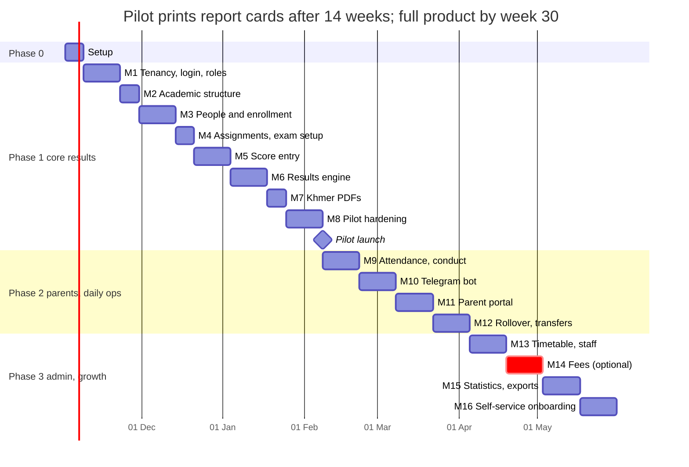

# Cambodia School Management System — Implementation Plan

Oct 21, 2026 · HIN CHEU

## Overview

One developer can take a pilot school from empty repo to printed Khmer report cards in about 14 weeks, then add parents, attendance and rollover in Phase 2 (about 8 weeks) and administration in Phase 3 (about 8 weeks). This plan implements the companion **Architecture Plan** doc; where they disagree, the architecture doc's Decisions table wins.

**Assumptions**

- Team: 1 full-stack developer, ~30 focused hours a week; one school contact who answers questions within 2 days
- Stack: Laravel 12, PHP 8.3, Vue 3 + Inertia 2, Tailwind 4, MySQL 8, Redis 7, Horizon, Gotenberg, Docker Compose on DigitalOcean
- Pilot school: one school from primary to high school (Grades 1–12), about 1,000–2,000 students, 50–90 teachers — so Phase 1 must handle primary scoring (subjects out of 10, simple average), secondary scoring (max score per subject, divisor) and the Grade 11–12 tracks from day one
- Estimates include tests; add 20% buffer for school feedback and Khmer layout fixes

**Definition of done (every task)**

- Feature works for two schools at once without leaking data between them
- Feature test + policy test pass in CI; Pint and Larastan level 6 clean
- Khmer and English labels in `lang/km` and `lang/en`; no hard-coded text in Vue
- Works on a 360 px phone screen and a desktop
- Migration is reversible; seeder updated; changelog line added

**Out of scope until real demand**: native mobile apps, LMS / homework, library, transport, canteen, health records, multi-campus chains.

## Timeline

Thirty weeks of work in three phases, with one hard gate: nothing from Phase 2 starts until the pilot school has printed real report cards at the end of week 14.



*Bars are in weeks from project start; "Pilot launch" is the hard gate at the end of week 14.*

The dashed bar (M14 Fees) is built only if a school asks for it; otherwise those two weeks go to M13 and M15.

## Phase 0 — Project setup (week 1)

Phase 0 ends when `docker compose up` gives a working login page, CI is green, and staging is deployed from `main`.

**Tasks**

- [ ] Create repo, branch rules: `main` = deployable, short-lived feature branches, squash merge, conventional commits (`feat:`, `fix:`)
- [ ] `laravel new` with no starter kit (Laravel 12's Vue kit is TypeScript-only), then add Inertia 2 + Vue 3 + Tailwind by hand in plain JavaScript: inertiajs/inertia-laravel, @inertiajs/vue3, @vitejs/plugin-vue, app.js entry; every .vue file uses \<script setup> in JavaScript
- [ ] Docker Compose: `nginx`, `app` (php-fpm 8.3), `worker` (Horizon + scheduler under supervisord), `mysql:8.4`, `redis:7`, `gotenberg:8`, `minio` (dev only), `mailpit` (dev only)
- [ ] Multi-stage Dockerfile: composer deps → node build → slim php-fpm runtime with opcache
- [ ] `.env.example` with every key documented: `MEDIA_*`, `BACKUP_*`, `GOTENBERG_URL`, `TELEGRAM_BOT_TOKEN`, `APP_LOCALE=km`
- [ ] GitHub Actions: Pint → Larastan → Pest (MySQL service) → `npm run build` → build image → deploy staging
- [ ] Self-host Khmer fonts (Khmer OS Battambang, Siemreap, Muol Light; Noto Sans Khmer as web fallback)
- [ ] Localisation: `lang/km/*.php`, `lang/en/*.php`, shared to Vue with `laravel-vue-i18n`; Khmer is the default
- [ ] Seeders: 2 demo schools, MoEYS subject template, demo users per role, 200 fake students with Khmer names
- [ ] `docs/` folder: README (setup in 5 commands), ADR folder, this plan's decisions

**Packages**

| Package | Purpose |
| --- | --- |
| `spatie/laravel-permission` | Roles and permissions, teams = school\_id |
| `spatie/laravel-activitylog` | Audit log on scores, results, people |
| `spatie/laravel-data` | Typed DTOs: `SchoolSettings`, request data, Inertia props |
| `laravel/horizon` | Queue dashboard and workers |
| `laravel/sanctum` | Session auth now, tokens for a future mobile API |
| `maatwebsite/excel` | Student import, score import / export, statistics export |
| `league/flysystem-aws-s3-v3` | Spaces, R2, MinIO through the s3 driver |
| `gotenberg/gotenberg-php` | HTML → PDF with correct Khmer shaping |
| `intervention/image` | Resize photos, strip EXIF |
| `pestphp/pest`, `larastan/larastan`, `laravel/pint` | Tests, static analysis, formatting |
| `laravel/telescope` (dev), `barryvdh/laravel-debugbar` (dev) | Debugging |
| Vue: `@tanstack/vue-table`, `vue-chartjs`, `dayjs` (km locale), `@vueuse/core` | Score grid base, charts, dates, helpers; plus sweetalert2 for pop-ups and toasts, restyled with the Sala design system (buttonsStyling: false + Sala classes) |

Telegram is called with Laravel's `Http` client directly — one small service class, no SDK dependency.

**Code conventions**

- Controllers stay thin: `FormRequest` → Action class → Inertia response
- PHP enums for every closed set (`ExamStatus`, `AttendanceStatus`, `Gender`, `EnrollmentStatus`)
- Money and scores never as float: `decimal(5,2)` for scores, integer minor units for money
- Every query that lists records is paginated or chunked; N+1 checked with `Model::preventLazyLoading()` in dev

**Frontend: JavaScript only, no TypeScript**

- `.js` files and `<script setup>` (JavaScript) in every component; no `lang="ts"`, no `tsconfig.json`
- Props declared with runtime types for safety: `defineProps({ scores: { type: Array, required: true } })`
- Shared shapes documented in `resources/js/types.md` (or JSDoc comments) instead of TypeScript interfaces
- ESLint (`eslint-plugin-vue`) + Prettier in CI catch most mistakes TypeScript would
- If copying examples from docs or packages written in TypeScript, delete the type annotations — the code works the same

## Folder structure and core building blocks

Build five building blocks in Milestone 1 before any feature, because every later module depends on them: current-school resolution, the tenancy trait, typed settings, the file store and the action pattern.

```text
app/
  Domain/
    School/        Models, Actions, Policies, Settings (SchoolSettings DTO)
    Academic/      AcademicYear, Term, GradeLevel, Track, Subject, CurriculumSubject, Classroom
    People/        Student, Guardian, Teacher, Enrollment, imports
    Exams/         Exam, Score, ExamResult, ResultCalculator, Ranker, MentionResolver
    Attendance/    Attendance, LeaveRequest, ConductRecord        (Phase 2)
    Communication/ Announcement, TelegramService, Notifications   (Phase 2)
    Finance/       FeeItem, Invoice, Payment, PaymentGateway      (Phase 3, behind flag)
  Support/
    Tenancy/       CurrentSchool, BelongsToSchool, ResolveSchool middleware
    Files/         FileStore, StoredFile model
    Pdf/           PdfRenderer (Gotenberg)
  Http/Controllers/{Admin,Teacher,Parent,Platform}/
resources/js/
  Pages/{Admin,Teacher,Parent,Platform}/
  Components/{ScoreGrid,AttendanceSheet,StudentPicker,KhmerDate}/
  Layouts/
resources/views/pdf/   report-card.blade.php, score-sheet.blade.php (HTML for Gotenberg)
tests/{Feature,Unit,Tenancy}/
```

**1. Current school**

- `ResolveSchool` middleware sets `CurrentSchool` (a scoped singleton) from subdomain or session switcher
- Also calls `setPermissionsTeamId($school->id)` for spatie permissions
- Queued jobs carry `school_id` and restore `CurrentSchool` in `handle()` — a job must never run without one

**2. Tenancy trait**

```php
trait BelongsToSchool
{
    protected static function bootBelongsToSchool(): void
    {
        static::addGlobalScope('school', function (Builder $q) {
            if ($id = app(CurrentSchool::class)->id()) {
                $q->where($q->qualifyColumn('school_id'), $id);
            }
        });
        static::creating(fn ($m) => $m->school_id ??= app(CurrentSchool::class)->idOrFail());
    }

    public function school(): BelongsTo { return $this->belongsTo(School::class); }
}
```

Tables reached only through a parent (e.g. `scores` via `exams`) still get a `school_id` column — cheaper queries and a second safety net.

**3. Typed settings** — `SchoolSettings` (spatie/laravel-data) validated on save, cached per school:

```php
final class SchoolSettings extends Data
{
    public function __construct(
        public string $averageMethod = 'divisor',      // divisor | weighted | simple
        public float  $semesterMonthlyWeight = 0.5,
        public float  $semesterExamWeight = 0.5,
        public float  $annualS1Weight = 0.5,
        public float  $annualS2Weight = 0.5,
        public string $absentSubjectPolicy = 'zero',   // zero | exclude_from_rank
        public bool   $rankAcrossGrade = true,
        public string $scoreApproverRole = 'homeroom',
        public string $attendanceMode = 'daily',       // daily | period | both
        public array  $promotionRules = [],
        public array  $modules = ['finance' => false],
        public bool   $khmerNumerals = false,
    ) {}
}
```

**4. File store** — the only class that touches `Storage`; `stored_files` keeps `disk`, `path`, `mime`, `size`, `checksum`, polymorphic owner. Methods: `put()`, `temporaryUrl()`, `delete()`, `migrate()`.

**5. Actions** — one class per business operation, called from controllers, jobs, commands and tests alike: `EnrollStudent`, `EnterScore`, `SubmitSubjectScores`, `ApproveExam`, `LockExam`, `PublishExam`, `PromoteStudents`. Each runs in a DB transaction and writes the activity log.

## Migration order

Create tables in eight batches so every foreign key points to a table that already exists; each batch maps to the milestone that first needs it.

1. **Platform and accounts (M1)** — `schools`, `users`, `school_user`, spatie permission tables (teams enabled), `activity_log`, `stored_files`
2. **Academic structure (M2)** — `academic_years` → `terms`; `grade_levels`, `tracks`, `subjects`, `rooms`; then `curriculum_subjects` (year + grade + track + subject), `grade_divisors`, `grading_scales`
3. **People (M3)** — `teachers`, `students`, `guardians`, `guardian_student`
4. **Classes and enrollment (M3)** — `classrooms` (needs year, grade, track, room, teacher) → `enrollments` (needs student, classroom, year)
5. **Teaching (M4)** — `teaching_assignments` (year, classroom, subject, teacher), `approval_assignments` (who approves scores for which grade)
6. **Exams (M4–M6)** — `exams` → `exam_classrooms`, `exam_subject_status` → `scores` → `exam_results`, `term_results`, `annual_results`, `score_change_requests`
7. **Phase 2** — `attendances`, `leave_requests`, `conduct_records`, `promotions`, `transfers`, `announcements`, `notification_logs`, `telegram_links`
8. **Phase 3** — `timetable_slots`, `staff_contracts`, then the Finance tables in their own folder `database/migrations/finance/`: `fee_items`, `fee_structures`, `discounts`, `invoices`, `invoice_lines`, `payments`, `receipts`

**Index and key rules**

- Every school-owned table: index starting with `school_id`, e.g. `(school_id, academic_year_id)`
- Unique keys include the school: `(school_id, student_code)`, `(school_id, staff_code)`, `(school_id, academic_year_id, name)` on classrooms
- `enrollments`: unique `(student_id, academic_year_id)`
- `scores`: unique `(exam_id, enrollment_id, subject_id)`, index `(exam_id, subject_id)` for the grid
- `exam_results`: unique `(exam_id, enrollment_id, version)`
- `attendances`: unique `(enrollment_id, date, session)`
- Foreign keys `restrictOnDelete` on academic data (never cascade-delete scores); soft deletes on people tables
- All text columns `utf8mb4_unicode_ci` so Khmer sorts and compares correctly

## Phase 1 — Core records and results (weeks 2–14)

Phase 1 is done when the pilot school prints one month's Khmer report cards from the system with correct averages and ranks; eight milestones get there, each ending in a demo to the school.

### M1 — Tenancy, login, roles (weeks 2–3)

- [ ] `schools`, `users`, `school_user`, permission tables; `BelongsToSchool`, `CurrentSchool`, `ResolveSchool`
- [ ] Login by email **or** phone (+855 normalised), password reset by email or by admin; 2FA for director / office / accountant
- [ ] Roles seeded per school: director, academic\_office, registrar, accountant, homeroom\_teacher, subject\_teacher, guardian, student; platform `super_admin` outside teams
- [ ] Platform pages: create school (name km/en, type, stage, province), invite first director by link
- [ ] School settings page: logo, brand colour, report header text, locale, Khmer numerals, all `SchoolSettings` fields with defaults
- [ ] School switcher for users who belong to several schools; language switcher km / en
- [ ] Layouts: admin sidebar, teacher mobile-first layout, empty states in Khmer

* **Tests**: tenancy suite (user of school A gets 404 on every school B route), role matrix tests, settings validation
* **Accepted when**: two demo schools, each with its own logo, cannot see each other's data

### M2 — Academic structure (week 4)

- [ ] CRUD: academic years (one `is_current`), terms, grade levels, tracks (optional), subjects, rooms
- [ ] "Apply MoEYS template" button: creates grade levels 1–12 and the standard subject list, editable after
- [ ] Curriculum editor: grid of grade × subject with max score, coefficient, pass score, order; per track when a grade has tracks
- [ ] Divisor (មេចែក) per grade / track; grading scale editor (mention bands km / en, letters)
- [ ] Classrooms: name, grade, track, shift (morning / afternoon), room, capacity, homeroom teacher (filled in M3)
- [ ] Copy curriculum from previous year

* **Tests**: curriculum per year is independent; deleting a subject used in scores is blocked
* **Accepted when**: the pilot school's real grades, subjects and max scores are entered

### M3 — Students, guardians, teachers, enrollment (weeks 5–6)

- [ ] Student form: Khmer + Latin names, gender, DOB, place of birth (province → district → commune → village selects), address, photo, ID Poor level, status
- [ ] Guardian form, link existing guardian by phone (prevents duplicates for siblings), relationship, primary contact
- [ ] Teacher form: profile + optional login, subjects they can teach, employment type
- [ ] Enroll students into a classroom; bulk move; roll numbers auto-sorted by Khmer name
- [ ] Excel import with preview: students + guardians + class in one sheet; row-level errors shown before saving; template download
- [ ] Student profile page: personal info, guardians, enrollment history, (later) results and attendance tabs
- [ ] Documents upload through `FileStore` (birth certificate, family book, photo)
- [ ] Search by Khmer or Latin name, code, phone

* **Tests**: import of 1,000 rows under 60 s in a queued job; duplicate guardian detection; unique enrollment per year
* **Accepted when**: the pilot school's full student list is imported and classes match their paper lists

### M4 — Teaching assignments and exam setup (week 7)

- [ ] Assignment matrix per classroom: subject → teacher; copy from last year
- [ ] Homeroom teacher per classroom; approver setting (default homeroom, or a chosen person / role per grade)
- [ ] Create exam: type (monthly / semester / final), month, term, dates, which grades / classrooms
- [ ] Exam status machine with PHP enum: `draft → open → approved → locked → published` (+ `returned` per subject)
- [ ] Teacher dashboard "My classes": classrooms and subjects assigned this year, open exams

* **Tests**: a teacher without an assignment cannot open the grid; status transitions only in allowed order

### M5 — Score entry (weeks 8–9)

- [ ] `ScoreGrid` Vue component: students down, one subject or all subjects across; arrow keys, Enter, Tab, paste a column from Excel
- [ ] Autosave each cell (debounced 500 ms) via `EnterScore`; optimistic UI with a saved / error dot per cell
- [ ] Validation: 0 ≤ score ≤ max, max two decimals, blank ≠ 0; absent (A) and exempt (E) markers
- [ ] Progress bar per subject ("28 / 32"), "Submit subject" button → `SubmitSubjectScores`
- [ ] Excel export of the empty sheet and import of filled sheets per subject
- [ ] Phone layout: one student per card, large number pad input
- [ ] Concurrency: last write wins per cell, but each write logged with user and old value

* **Tests**: 45 students × 12 subjects saves without lost cells; locked exam rejects writes with 423
* **Accepted when**: 3 real teachers enter one month's scores without help

### M6 — Results engine, approval, lock, publish (weeks 10–11)

- [ ] `ResultCalculator`, `Ranker`, `MentionResolver` (see the engine section below)
- [ ] Class result sheet: live averages and ranks while open; highlighting of missing scores
- [ ] Approval flow: approver reviews class sheet → approve or return a subject with a note → academic office locks
- [ ] `LockExam` dispatches `CalculateExamResults` per classroom (queue), then grade-wide ranking, writes `exam_results` with version
- [ ] Semester and annual result calculation from locked exams
- [ ] `score_change_requests` after lock: teacher requests, director approves, results recalculated as new version
- [ ] Results pages: class ranking, grade ranking, student result history, subject statistics (average, pass rate, total / female)

* **Tests**: golden-file tests with a real paper sheet from the school — the system must match its totals, averages and ranks exactly
* **Accepted when**: one past month recalculated by the system matches the school's paper results 100%

### M7 — Khmer PDF documents (week 12)

- [ ] `PdfRenderer` service: Blade HTML → Gotenberg → PDF stored via `FileStore` (keyed by exam + version)
- [ ] Monthly score sheet (A4 landscape), report card per student (A4 or A5), honor roll
- [ ] Kingdom header, school logo, Khmer + Gregorian date, Khmer numerals option, signature blocks
- [ ] Bulk generation per class as one merged PDF, queued; download link when ready

* **Tests**: snapshot test of rendered HTML; manual check of Khmer subscripts (្) on printed paper
* **Accepted when**: the school prints report cards and staff approve the look

### M8 — Pilot hardening and launch (weeks 13–14)

- [ ] Activity log viewer for director (score changes, who did what)
- [ ] Performance pass: grid load < 1 s for 50 × 15, result calc < 10 s per grade
- [ ] Production deploy, backups verified, monitoring and Telegram alerts
- [ ] Training: 1-hour session each for office staff and teachers; 2-page Khmer guide with screenshots
- [ ] Feedback channel: Telegram group with the school; bug triage twice a week

* **Accepted when**: the launch checklist at the end of this doc is fully ticked

## Result calculation engine

The engine is three small pure classes plus one queued job, so every rule can be unit-tested with arrays and no database.

**Algorithm per classroom (one exam)**

1. Load enrollments (status active), curriculum subjects for the grade / track, all scores for the exam
2. For each student: total = sum of scores; absent subjects marked
3. Apply `absentSubjectPolicy`: `zero` → absent counts 0; `exclude_from_rank` → student gets average but no rank
4. Average by `averageMethod`: `divisor` → total ÷ divisor; `weighted` → Σ(score ÷ max × 10 × coef) ÷ Σ coef; `simple` → mean
5. Round to 2 decimals **once**, at the end (round half up), and rank on the rounded value so the printed sheet and the rank agree
6. Rank in class with competition ranking (1, 2, 2, 4); then, when all classrooms of the grade are done, rank across the grade
7. Mention from `grading_scales`; pass / fail from the pass line and custom promotion rules
8. Write `exam_results` rows for this version in one transaction; mark the exam's calc status done

**Semester and annual**: monthly average = mean of the term's locked monthly exam averages; semester = w\_m × monthly average + w\_e × semester exam average; annual = w\_1 × S1 + w\_2 × S2; ranks and mentions recomputed the same way.

**Code skeleton**

```php
final class ResultCalculator
{
    public function __construct(private SchoolSettings $s) {}

    /** @param array<int, array<int, ?float>> $scores  enrollmentId => [subjectId => score|null] */
    public function averages(array $scores, Curriculum $c): array
    {
        $out = [];
        foreach ($scores as $enrollmentId => $bySubject) {
            $absent = array_keys(array_filter($bySubject, fn ($v) => $v === null));
            $total  = array_sum(array_map(fn ($v) => $v ?? 0, $bySubject));
            $avg = match ($this->s->averageMethod) {
                'divisor'  => $total / $c->divisor,
                'weighted' => $c->weightedAverage($bySubject),
                'simple'   => $total / max(count($bySubject), 1),
            };
            $out[$enrollmentId] = [
                'total'    => round($total, 2),
                'average'  => round($avg, 2),
                'absent'   => $absent,
                'rankable' => !($absent && $this->s->absentSubjectPolicy === 'exclude_from_rank'),
            ];
        }
        return $out;
    }
}

final class Ranker
{
    /** competition ranking: 1, 2, 2, 4 */
    public function rank(array $averages): array
    {
        arsort($averages);
        $ranks = []; $pos = 0; $prev = null; $rank = 0;
        foreach ($averages as $id => $avg) {
            $pos++;
            if ($avg !== $prev) { $rank = $pos; $prev = $avg; }
            $ranks[$id] = $rank;
        }
        return $ranks;
    }
}
```

**Job flow**

- `LockExam` action → `Bus::batch([...CalculateClassroomResults per classroom])` → `then(RankAcrossGrade)` → `then(NotifyResultsReady)`
- Jobs are idempotent: re-running a version deletes and rewrites only that version's rows
- Live preview while scores are open uses the same classes in memory, no writes

**Unit tests to write first**: ties, all-absent student, exclude-from-rank policy, divisor vs weighted, rounding edge (x.xx5), grade-wide rank with different class sizes, one student class.

## Phase 2 — Daily operations and parents (weeks 15–22)

Phase 2 is done when parents receive results and absence alerts on Telegram and the school rolls into a new academic year without manual data entry.

### M9 — Attendance, leave, conduct (weeks 15–16)

- [ ] `attendanceMode` respected: daily sheet (homeroom), period sheet (subject teacher), or both
- [ ] Daily sheet: everyone present by default, tap to mark permission / no permission / late; morning and afternoon shift sessions
- [ ] Leave requests: created by office now, by parents in M11; approved leave pre-marks "permission"
- [ ] Monthly attendance totals per student feed the report card and promotion rules
- [ ] Conduct grade + comment per student per term (homeroom); incident log with date and action taken
- [ ] School calendar: holidays and non-school days so attendance isn't expected on them

* **Tests**: attendance unique per enrollment / date / session; holiday blocks entry; totals match records

### M10 — Telegram bot (weeks 17–18)

- [ ] One bot per platform (or per school, configurable), webhook route with secret token check
- [ ] Link flow: guardian link code (printed slip or SMS) → `/start CODE` → `telegram_links` row; unlink command
- [ ] Commands in Khmer: results, attendance, children (switch), help; inline buttons instead of typing
- [ ] Notifications as queued Laravel Notifications with a `TelegramChannel`: results published, absent without permission, 3 lates / month, announcements
- [ ] Rate limiting (stay under Telegram's per-chat and global limits), retries with backoff, `notification_logs` with status
- [ ] Office view: which guardians are linked, last delivery, failed sends

* **Tests**: fake Telegram HTTP; link code single-use and expires in 7 days; one guardian with 3 children gets one message per child event

### M11 — Parent and student portal (weeks 19–20)

- [ ] Guardian login by phone + one-time code (Telegram or SMS) — no password to forget
- [ ] One account shows all linked children; child switcher at top
- [ ] Pages: results per exam with rank and mention, trend chart across the year, attendance calendar, report card PDF, announcements
- [ ] Leave request form with photo upload; status visible
- [ ] Report card acknowledgement ("បានឃើញ") recorded with time
- [ ] Student login (Grade 7+): own results and timetable only
- [ ] PWA manifest + offline shell; Khmer default

* **Tests**: guardian sees only linked children (policy test per page); unpublished results invisible

### M12 — Year rollover, promotion, transfers (weeks 21–22)

- [ ] Promotion screen per classroom: system suggests promote / repeat / graduate from annual results + rules; homeroom or office can override with a reason
- [ ] Rollover wizard: create next academic year → copy terms pattern, grades, curriculum, classrooms, assignments → enroll promoted students into the next grade's classrooms (bulk assign by list)
- [ ] Transfer out: certificate / letter PDF, status `transferred`, history kept; transfer in: create student + previous results summary
- [ ] Dropout tracking with reason and date
- [ ] Graduation: Grade 12 students marked graduated, records kept read-only

* **Tests**: rollover on a copy of pilot data; no student enrolled twice in the new year; previous year becomes read-only

## Phase 3 — Administration and growth (weeks 23–30)

Phase 3 turns the pilot into a product other schools can sign up for; the fees module is built here only if a school actually needs it, otherwise its weeks go to timetable and statistics.

### M13 — Timetable and staff (weeks 23–24)

- [ ] Periods per shift (start / end times), weekly grid per classroom
- [ ] Drag a teaching assignment into a slot; clash detection (teacher, room, classroom) and weekly hours per teacher
- [ ] Substitute teacher for a date; teacher's own timetable on their dashboard and in Telegram
- [ ] Staff profiles: qualifications, contracts, staff attendance and leave

### M14 — Fees module, optional (weeks 25–26, only when needed)

- [ ] Enable via `settings.modules.finance`; routes, menu and policies hidden when off
- [ ] Fee items and fee structures per grade and year (USD / KHR, integer minor units)
- [ ] Discounts: sibling, scholarship, ID Poor, manual with reason
- [ ] Invoice generation listening to `StudentEnrolled` / `StudentTransferred` events; due dates, overdue reminders by Telegram
- [ ] Payments: cash at office first; `PaymentGateway` contract with KHQR and ABA PayWay drivers + webhook verification
- [ ] Receipts PDF (Khmer), daily cash report, outstanding balance report

* **Tests**: Finance can be removed (flag off) and every Phase 1–2 test still passes

### M15 — Statistics and exports (weeks 27–28)

- [ ] Director dashboard: students by grade (total / female), attendance rate, pass rate by subject and class, at-risk students (falling two exams in a row)
- [ ] Exports to Excel of every list; MoEYS-style statistics export once the school provides the template
- [ ] Document verification: QR code on report cards and certificates → public verify page showing name, class, year, issue date

### M16 — Self-service onboarding (weeks 29–30)

- [ ] Public sign-up request → platform admin approves → setup wizard: profile, logo, MoEYS template, academic year, first import
- [ ] Plans and limits per school (students, storage); usage page
- [ ] Per-school data export (ZIP of Excel + files) and account closure
- [ ] Platform admin: impersonate a school user for support (logged, time-limited)

## Screens and routes

About 45 Inertia pages in four route groups; each group has its own middleware stack and layout.

| Route prefix | Middleware | Layout | Key pages | Milestone |
| --- | --- | --- | --- | --- |
| `/platform` | auth, super\_admin | Platform | Schools list, create school, plans, impersonate, system health | M1, M16 |
| `/admin/settings` | auth, school, role:director | Admin | School profile and branding, grading rules, approver, attendance mode, modules | M1 |
| `/admin/academic` | auth, school, role:director\|academic\_office | Admin | Years, terms, grades, tracks, subjects, curriculum grid, divisors, grading scales, classrooms, rooms | M2 |
| `/admin/people` | auth, school, role:registrar\|director | Admin | Students list / form / profile, guardians, teachers, import wizard, enrollment board | M3 |
| `/admin/teaching` | auth, school, role:academic\_office | Admin | Assignment matrix, homeroom teachers, approvers | M4 |
| `/admin/exams` | auth, school, role:academic\_office | Admin | Exams list, create exam, progress dashboard, approve / lock / publish, change requests | M4, M6 |
| `/admin/results` | auth, school, staff | Admin | Class ranking, grade ranking, statistics, PDF downloads | M6, M7 |
| `/admin/attendance` | auth, school, staff | Admin | Daily overview, reports, calendar | M9 |
| `/admin/rollover` | auth, school, role:director | Admin | Promotion review, rollover wizard, transfers | M12 |
| `/admin/finance` | auth, school, module:finance, role:accountant | Admin | Fee structures, invoices, payments, receipts | M14 |
| `/teacher` | auth, school, teacher | Teacher (mobile-first) | My classes, score grid, attendance sheet, class result sheet, conduct, messages | M4–M9 |
| `/parent` | auth, school, guardian | Parent (mobile) | Children, results, trend, attendance, leave request, report card, announcements | M11 |
| `/student` | auth, school, student | Parent (mobile) | My results, timetable | M11 |
| `/telegram/webhook/{secret}` | throttle, verify token | — | Bot updates (JSON) | M10 |
| `/verify/{code}` | public, throttle | Public | Document verification | M15 |

Score cell writes go to a small JSON endpoint (`PUT /teacher/exams/{exam}/scores`) instead of full Inertia reloads, so the grid stays fast.

## Testing strategy

Two test suites protect the things a school cannot forgive: one school seeing another's data, and a wrong average or rank on a printed report card.

| Layer | Tool | What it covers | Target |
| --- | --- | --- | --- |
| Unit | Pest | `ResultCalculator`, `Ranker`, `MentionResolver`, settings validation, phone normalisation, Khmer sort | 100% of engine branches |
| Feature | Pest + `RefreshDatabase` (MySQL in CI) | Every action and controller: happy path, validation, policy denial | Every route has at least one allow and one deny test |
| Tenancy | Pest dataset over all routes | Logged in as school A, request each school B resource → 404 | Runs on every push; build fails on any leak |
| Golden files | Pest + fixtures from the pilot school | Real paper score sheets (anonymised) → system totals, averages, ranks must match exactly | Added for each new school's rules |
| Jobs and notifications | `Bus::fake`, `Notification::fake`, `Http::fake` (Telegram, Gotenberg) | Lock → batch → grade rank → notify; retries; idempotency | All queued flows |
| Files | `Storage::fake` on local and s3 disks | Upload, temporary URL, delete, `storage:migrate` | Both drivers |
| Import | Fixtures with bad rows | Excel import preview errors, duplicates, Khmer text intact | 1,000-row file |
| Frontend | Vitest + Vue Test Utils (JavaScript) | `ScoreGrid` keyboard navigation, validation, autosave states | Grid and attendance sheet |
| Browser | Laravel Dusk (a few smoke tests) | Login, enter a score, lock exam, download PDF | Before each release |
| Manual | Printed paper | Khmer PDF shaping, layout on A4 / A5 | Each template change |

**Test data**: factories generate realistic Khmer names, +855 phones, provinces; a `PilotSchoolSeeder` loads an anonymised copy of the pilot school for demos and performance checks.

## Environments, CI/CD and operations

Three environments, one Docker image promoted from staging to production, and zero-downtime deploys outside school hours.

| Environment | Where | Data | Storage | Deploys |
| --- | --- | --- | --- | --- |
| Local | Docker Compose on your machine | Seeders + demo schools | MinIO or local disk | On save (Vite HMR) |
| Staging | Small DigitalOcean droplet | Anonymised pilot copy, refreshed weekly | Separate bucket | Every merge to `main` |
| Production | DigitalOcean droplet (2 vCPU / 4 GB to start), Singapore region | Real schools | R2 or Spaces (switchable), backups on the other provider | Manual approval in GitHub Actions |

**Pipeline** (GitHub Actions)

1. Pint, ESLint, Larastan level 6
2. Pest (MySQL + Redis services), Vitest
3. Build multi-stage image, tag with commit SHA, push to registry (GHCR or DigitalOcean Container Registry)
4. Deploy staging: `docker compose pull && up -d`, `php artisan migrate --force`, `optimize`, `horizon:terminate`
5. Smoke test staging (health endpoint + Dusk login test)
6. Promote the same SHA to production after approval

**Deploy rules**

- Never deploy during exam score-entry deadlines or 07:00–17:00 on school days; preferred window 19:00–22:00 Phnom Penh time
- Migrations must be backward compatible for one release (add column → deploy → backfill → drop old later)
- Maintenance mode only with a Khmer message and a time estimate

**Backups and recovery**

- MySQL: nightly `mysqldump` + hourly binlog to the backup disk; keep 30 daily, 12 monthly
- Files: daily `rclone sync` of the media bucket to the backup provider
- Restore drill once per term on staging; target: back online in 2 hours, at most 1 hour of data lost

**Monitoring**

- Health endpoint (DB, Redis, queue, Gotenberg, storage) polled every minute
- Telegram alerts to you: failed jobs, queue backlog > 5 minutes, disk > 80%, backup failure, 5xx spike
- Error tracking: Sentry (free tier) or Laravel's log channel to a Telegram bot for errors
- Horizon dashboard behind super\_admin; slow query log on; weekly look at the 10 slowest queries

## Onboarding a school

A new school goes live in about two weeks if its student list exists in Excel; most of the time is cleaning their data, not configuring the system.

1. **Collect** (day 1–3): logo, grade and subject list with max scores, divisor and mention bands, a real printed score sheet and report card, the student list (Excel or photos of paper registers), teacher list, guardian phones
2. **Configure** (day 4–5): create school, apply MoEYS template, adjust curriculum, divisors, grading scale, settings (average method, absent policy, approver, attendance mode)
3. **Clean** (day 5–8): map their columns to the import template; fix Khmer encoding (legacy Limon fonts → Unicode with a converter step), split full names into family / given name, normalise phones, merge duplicate guardians
4. **Import** (day 8): teachers → classrooms → students + guardians + enrollment; review the preview errors with the registrar
5. **Verify** (day 9–10): class lists printed and checked by each homeroom teacher; recalculate one past month and compare with their paper results (golden-file test)
6. **Train** (day 11): office staff 1 hour, teachers 1 hour on phones; leave the 2-page Khmer guide
7. **Go live** (day 12–14): first real exam entered in the system; you watch the logs and answer in the school's Telegram group

**Import tooling to build in M3**

- Downloadable Excel template with Khmer headers and a filled example row
- Column mapper (their header → our field) saved per school for re-use
- Legacy Khmer font detection: warn when text looks like Limon / non-Unicode
- Dry run with a downloadable error report; import runs as a job with progress

## Risks and mitigations

The biggest risk is not technical: it is a school whose real rules differ from what you built, discovered only when report cards are printed.

| Risk | Impact | Mitigation |
| --- | --- | --- |
| School's calculation rules differ from assumptions | Wrong ranks on report cards, trust lost | Golden-file test from their real paper sheets before go-live; every rule is a setting |
| Khmer text breaks in PDFs | Unreadable report cards | Gotenberg from M7 day 1, embedded fonts, print test on paper |
| Teachers find score entry slower than paper / Excel | Adoption fails | Excel-like grid, Excel import, phone layout; test with 3 real teachers in M5 |
| Weak internet at school | Lost scores, frustration | Autosave per cell, retry queue in the browser, optional offline mode later |
| Data leak between schools | Legal and reputation damage | Global scope + `school_id` everywhere + tenancy test suite on every push |
| Solo developer unavailable | No support during exams | Runbook in `docs/`, monitoring alerts, deploy freeze during exam weeks |
| Legacy (non-Unicode) Khmer in imports | Garbled names | Detection + conversion step in the import wizard |
| Parents don't link Telegram | Notifications unused | Printed link slips with QR at parent meetings; office view of unlinked guardians; SMS fallback later |
| Scope creep (fees, LMS, timetable early) | Phase 1 slips | Phase gates: nothing from Phase 2+ until the M8 checklist is complete |
| Storage provider change or outage | Missing photos and PDFs | `FileStore` abstraction, backups on a second provider, `storage:migrate` tested |

## Pilot launch checklist

Tick every item before the pilot school's first real exam goes into the system.

**Data**

- [ ] All students imported, class lists signed off by each homeroom teacher
- [ ] Curriculum, max scores, divisors and mention bands confirmed in writing by the academic office
- [ ] One past month recalculated and matches paper results exactly

**People**

- [ ] Every teacher can log in on their own phone
- [ ] Approver for each grade set; director and office have 2FA on
- [ ] Training sessions done; Khmer quick guide handed out; school Telegram support group created

**System**

- [ ] Tenancy test suite green; no failed jobs in Horizon for 7 days on staging
- [ ] Report card and score sheet PDFs printed and approved
- [ ] Production backups ran and one restore tested on staging
- [ ] Monitoring and Telegram alerts firing to you (test alert received)
- [ ] Storage on the chosen provider, backups on the other; `storage:migrate` dry run passed
- [ ] Deploy freeze dates for the exam period agreed with the school

**After the first exam cycle**

- [ ] Feedback session with teachers and office; list of fixes prioritised
- [ ] Decide go / no-go for Phase 2 start
